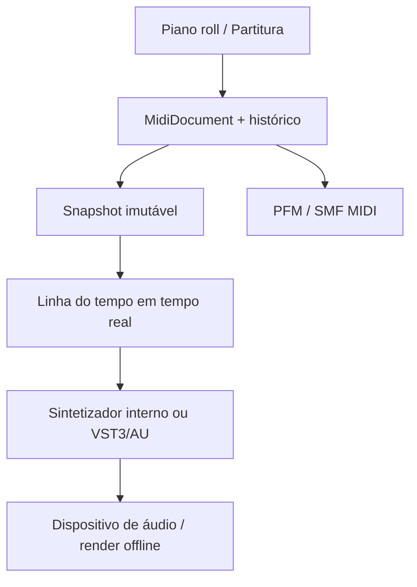

# Arquitetura do PulseForge MIDI

## Visão geral

## Camadas

### Modelo independente

`CoreTypes`, `MidiDocument` e `Quantizer` usam apenas a biblioteca padrão C++20.
Eles concentram identidade de eventos, limites, operações de seleção, clipboard e
histórico. Isso possibilita testes unitários rápidos, sem inicializar áudio ou GUI.

### Interface

`PianoRollComponent` e `ScoreComponent` são visualizações editáveis do mesmo
documento. Nenhuma delas possui uma cópia autoritativa das notas; qualquer edição
entra pelo `MidiDocument`, e ambas são redesenhadas após a notificação de mudança.

### Áudio em tempo real

`AudioEngine::makeTimeline` converte o projeto em eventos MIDI ordenados fora do
callback. Um `shared_ptr` atômico substitui a linha do tempo inteira em uma única
operação. O callback faz busca binária nos eventos do bloco corrente e evita obter
o mutex do documento.

O sintetizador interno tem 32 vozes com ADSR. Quando um plug-in é carregado, ele
recebe o mesmo `MidiBuffer` e substitui o sintetizador interno no caminho de saída.

### Entrada e saída

- `MidiFileIO`: Standard MIDI File com PPQ, metaeventos, pistas, notas, CC e pitch.
- `ProjectIO`: JSON `.pfm`, mantendo dados que um SMF não expressa diretamente.
- `AudioEngine::renderToAudioFile`: processamento não realtime em blocos de 512
  amostras, 48 kHz/24-bit, com dois segundos de cauda para releases e reverb.

## Decisões de desempenho

- C++20 e build Release com LTO recomendado pelo JUCE.
- Linha do tempo contígua e ordenada, com busca `O(log n)` por bloco.
- Snapshot criado na thread da interface, nunca na thread de áudio.
- Buffer de áudio pré-alocado para até 64 canais no caminho realtime.
- `ScopedTryLock` para evitar que troca/abertura de plug-in congele o callback.
- O exportador offline reutiliza a mesma semântica de eventos da reprodução.

## Pontos de extensão

- Substituir o processador único por `juce::AudioProcessorGraph` para VSTi por pista.
- Adicionar mapa de tempo em `Project` e converter beat/amostra por segmentos.
- MPE: associar cada voz a um canal e guardar expressão por nota.
- Gravação em tempo real: transformar mensagens do `MidiMessageCollector` em ações
  agrupadas do documento.
- MusicXML: uma camada de notação separada do tempo MIDI contínuo.
