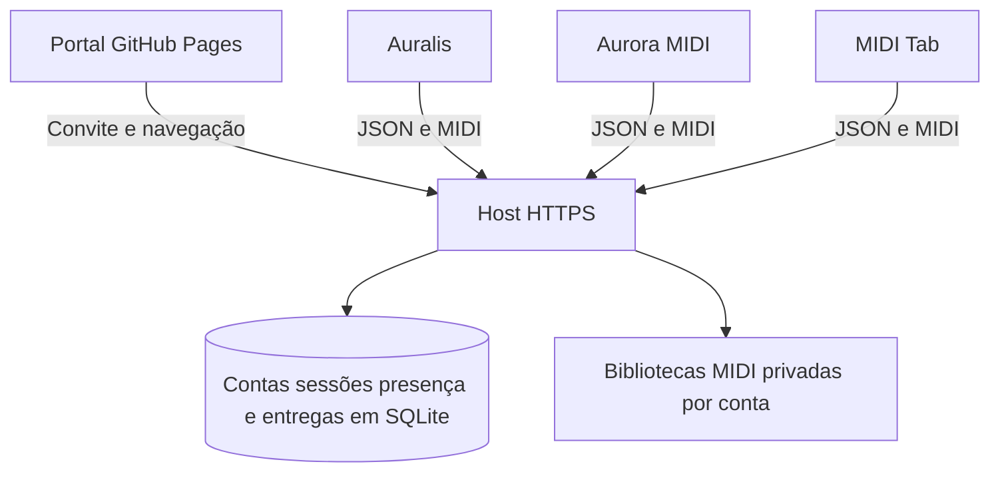

# Arquitetura do host e do Estúdio conectado

O anfitrião mantém um processo Python. Em modo de internet temporária, cloudflared conecta esse processo ao endpoint HTTPS externo. O navegador acessa os aplicativos e a API na mesma origem HTTPS; não usa cookies entre origens. O Pages só distribui ferramentas públicas e o seletor de host.

Envio: a ferramenta serializa o MIDI, a API autentica a conta e grava o item, e a API do estúdio registra uma referência ao destinatário da mesma conta. O destino consulta suas ofertas, obtém os bytes do catálogo e confirma a importação. Presença e histórico são centralizados e persistidos. Os três motores musicais continuam nos clientes.

Trata-se de arquitetura cliente-servidor com distribuição entre máquinas quando navegadores remotos acessam o host. O transporte do túnel não transforma o banco em distribuído. Não há P2P, migração automática de anfitrião, coordenação de edição simultânea ou sincronização de reprodução. Sem o anfitrião, a biblioteca e as entregas ficam indisponíveis; o modo público permite uso local das ferramentas.
